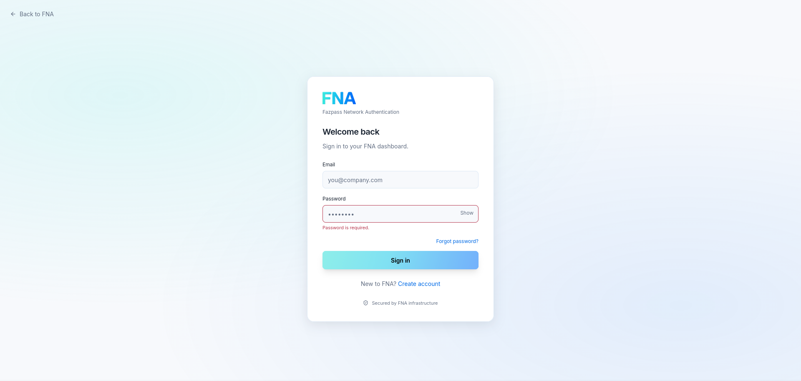
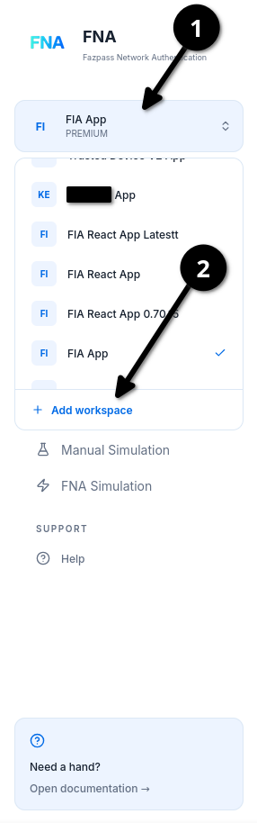
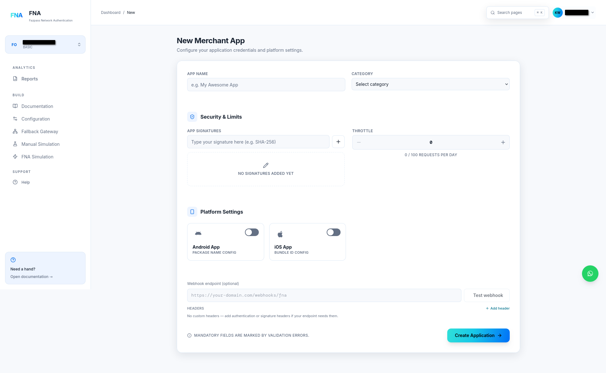
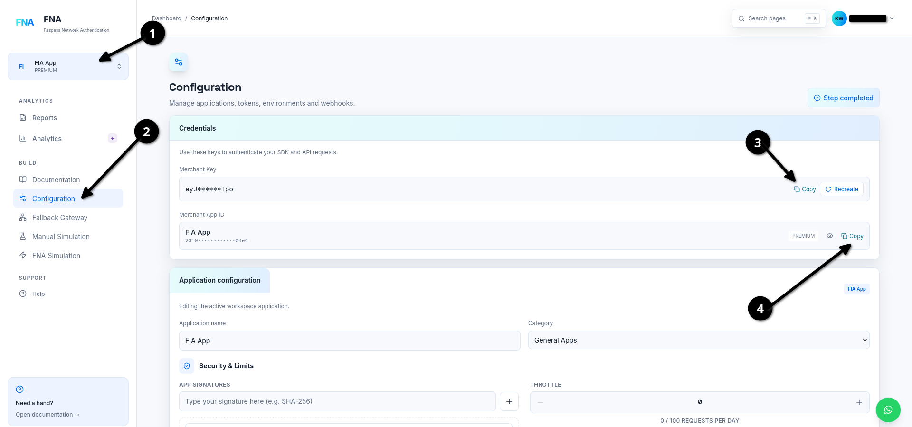
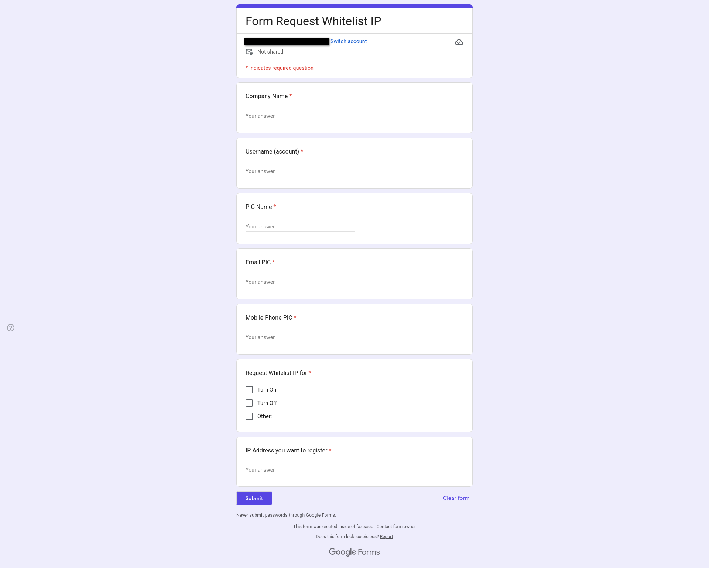

# FIA Documentation (Dashboard)

Documentation on how to use FNA Dashboard.

# Getting Started

First, you have to login in the [FNA Dashboard](https://fna.fazpass.com/login).

# Create a new Merchant App

On the Dashboard sidebar, click the Workspace dropdown, then click 'Add Workspace'.

Fill the form, add your app package name / identifier bundle, then click 'Create Application'.

# Retrieve your Merchant Key & App ID

On the Dashboard sidebar, Pick your app on the Workspace dropdown, then click the 'Configuration' menu, then click the 'Copy' button at the end of the textbox.

# Whitelist IP

Fill out this google form: https://docs.google.com/forms/d/e/1FAIpQLSftJNDZsfPCGA3LqZY7hsDiFMy4Pb5d3SBgPMEG7YdNXJ6hcQ/viewform

